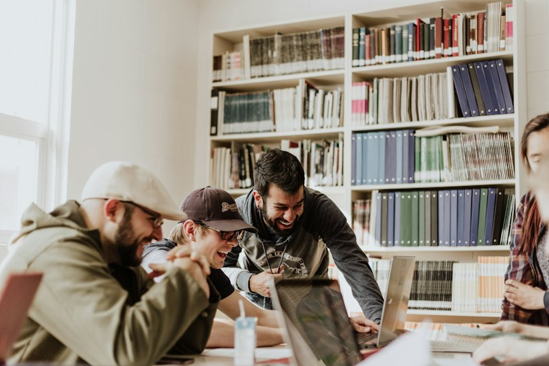
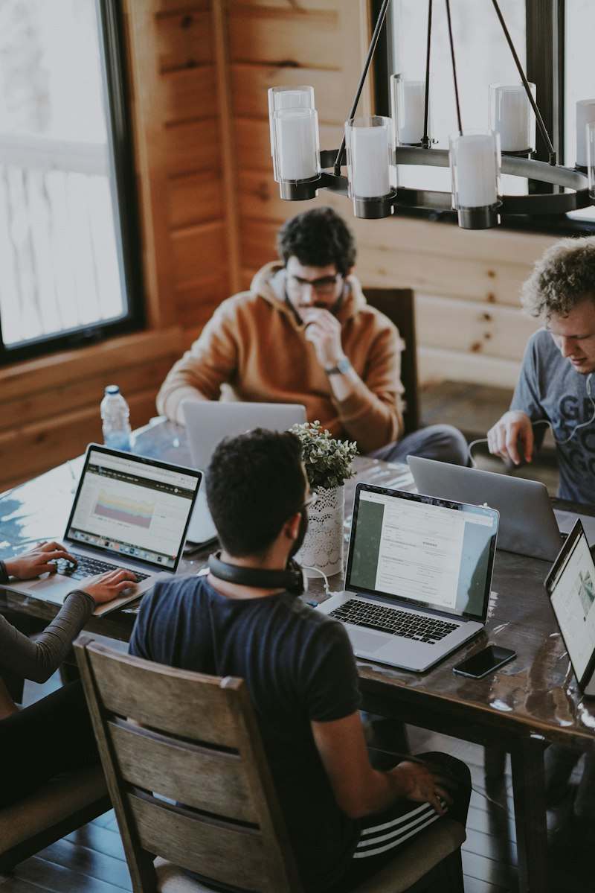
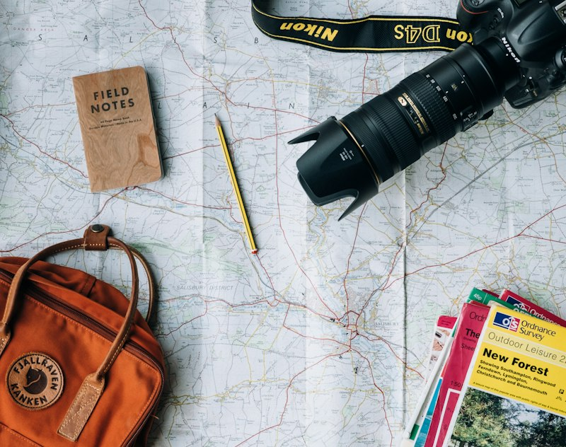
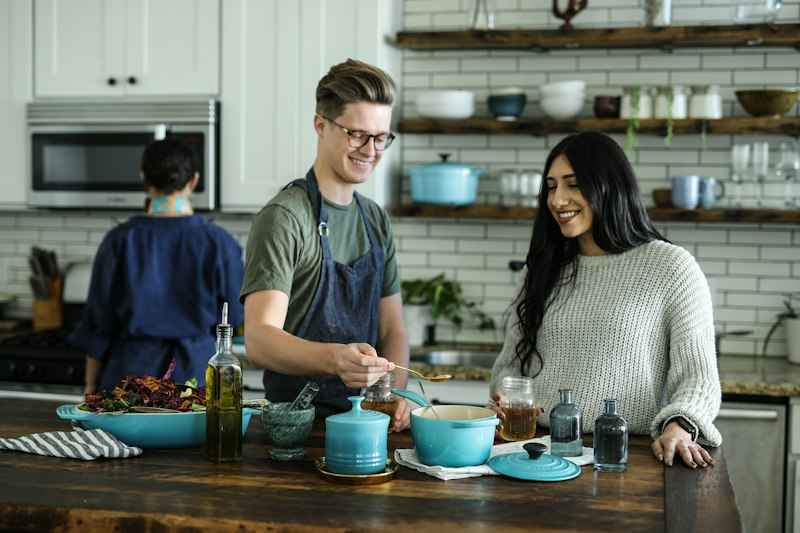
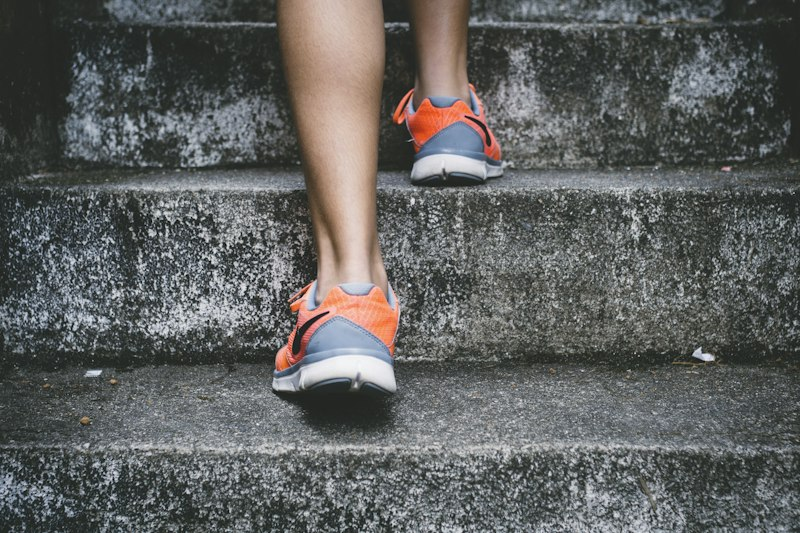
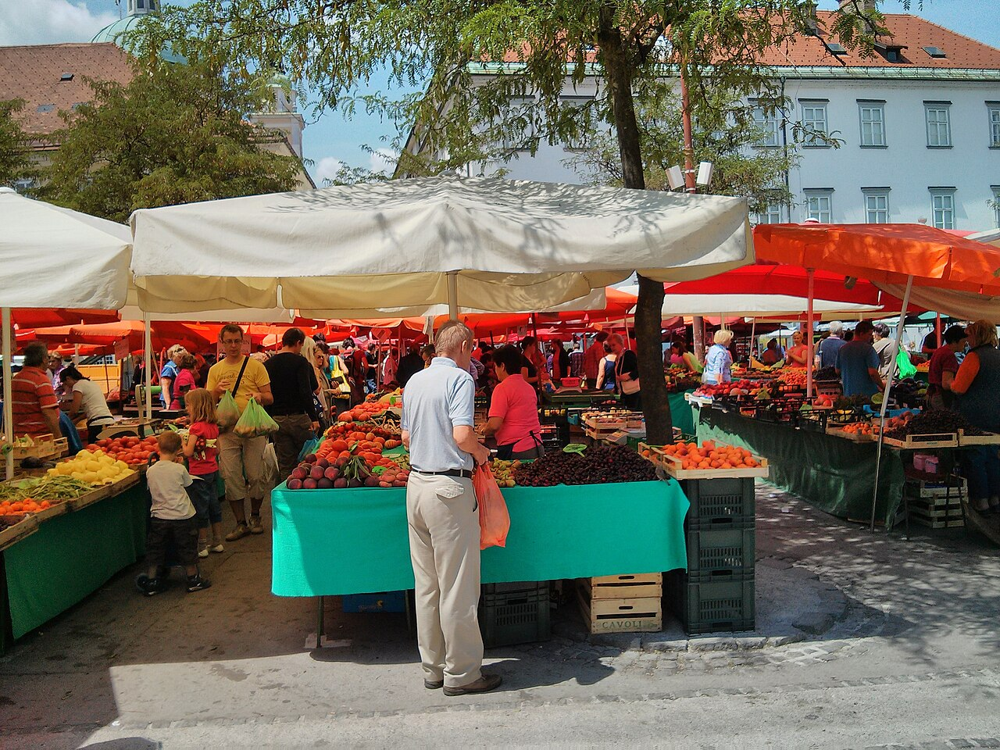
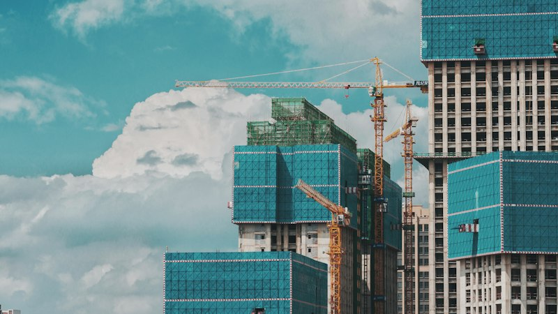
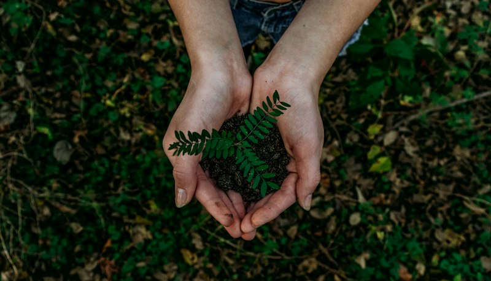
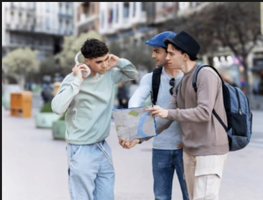

# Практикум: Описание иллюстраций (Zadanie 2 — Opis ilustracji)

Практический сборник экзаменационных карточек для подготовки к **Заданию 2 (Opis ilustracji i odpowiedzi na pytania)** устной части экзамена Matura по английскому языку (Formuła 2023, CKE).

---

## Регламент и алгоритм выполнения Задания 2

* **Цель задания:** проверка навыков спонтанной монологической и диалогической речи, умения детально описывать визуальный материал и аргументированно отвечать на вопросы экзаменатора.
* **Время ответа:** около 3 минут (из них около 1–1.5 минут на описание картинки и 1.5–2 минуты на 3 вопроса).

### Единая структура описания (CKE Formula)

Каждое описание в сборнике строго структурировано по 6 обязательным элементам:
* **Вводная фраза (Introduction):** общее обозначение сюжета фотографии (*In the picture, I can see... / The photograph shows...*).
* **Где происходит действие (Where & Location):** место и пространственная ориентация (*indoors/outdoors, in the foreground, in the background, on the left/right*).
* **Кто изображен (Who & Appearance):** возраст, количество людей, социальные роли, одежда и приметы (*a group of teenagers, a doctor in a white coat, casual clothes*).
* **Что делают персонажи (What they are doing):** ключевые действия в процессе — **строго во времени Present Continuous** (*they are discussing, she is looking at, he is holding*).
* **Атмосфера и предположения (Atmosphere & Deductions):** настроение, эмоции персонажей, модальные конструкции (*they seem to be..., judging by their expressions, it looks as if...*).
* **Заключение и личное отношение (Conclusion & Personal Attitude):** завершающая фраза с выражением собственного мнения, впечатления или личной ассоциации (*Personally, I find this picture very relatable/inspiring because... / To sum up, this scene reminds me of...*).

---

## Тематический блок: Образование и учеба (Education)

### Описание иллюстрации по структуре

* **Вводная фраза (Introduction):** In the picture, I can see a group of young people engaged in study.
* **Где происходит действие (Where):** They are indoors, sitting around a wooden table in what appears to be a university library or a modern study centre. Natural daylight is coming through a window in the background.
* **Кто изображен (Who):** There are several male and female high school or university students in their late teens. They are dressed in casual student clothes like hoodies, jumpers, and shirts.
* **Что делают (What — Present Continuous):** They are working together on an academic assignment. Some of them are taking notes in their copybooks, while others are pointing at open textbooks and looking at a shared laptop screen.
* **Атмосфера и предположения (Atmosphere & Deductions):** Judging by their smiling and engaged facial expressions, the atmosphere is collaborative, friendly, and productive. They seem to enjoy studying together.
* **Заключение и личное отношение (Conclusion & Personal Attitude):** Personally, I really like this picture because it reminds me of preparing for exams with my close classmates, which always makes studying much less stressful and far more enjoyable.
* **Связный образцовый ответ (Full Model Answer):**
  "In the picture, I can see a group of young students sitting together at a wooden table in what looks like a modern university library or study room. There are several young men and women dressed in casual clothes gathered around notebooks, open textbooks, and a laptop. They are discussing an assignment, taking notes, and sharing ideas with each other. Everyone looks genuinely involved and concentrated on their teamwork. The atmosphere seems very productive, supportive, and friendly. Personally, I really like this picture because it reminds me of preparing for exams with my own classmates, which always makes revision much less stressful."

### Вопросы экзаменатора и примерные ответы

* **Question:** Why do you think the students decided to study together rather than on their own?
  * **Answer:** "In my opinion, studying in a group allows them to exchange different perspectives and clarify difficult topics much faster. When someone doesn't understand a concept, others can explain it in simple terms. Additionally, it makes the learning process more motivating and less stressful."
* **Question:** Tell me about a school project or group task you participated in.
  * **Answer:** "Last term in our biology class, my classmates and I had to prepare a presentation on renewable energy sources. We divided the responsibilities: I searched for facts and statistics, while my friend designed the slides. It took us several days to finish, but we received an excellent mark and learned how to cooperate under time pressure."
* **Question:** Do you think laptops and tablets will ever completely replace paper books in classrooms? Why or why not?
  * **Answer:** "I don't think paper books will disappear entirely. While digital devices are portable and give immediate access to vast information, many students, including myself, find it much easier to concentrate and retain information when reading physical paper books without screen glare and digital notifications."

### Полезный словарный запас

* `collaborative learning` — совместное обучение
* `to bounce ideas off each other` — обмениваться идеями
* `to focus on an assignment` — сосредоточиться на задании
* `in the foreground / background` — на переднем / заднем плане
* `personally, it reminds me of...` — лично мне это напоминает о...

---

## Тематический блок: Работа и карьера (Work)

### Описание иллюстрации по структуре

* **Вводная фраза (Introduction):** The photograph shows a group of young people working together on laptops in an informal setting.
* **Где происходит действие (Where):** The scene takes place indoors, in a cozy room with wooden walls that looks like a rustic co-working space, a shared cabin, or a modern rental home. They are gathered around a large wooden dining table under a chandelier with candle-style lamps.
* **Кто изображен (Who):** There are several young people dressed very casually in comfortable everyday clothes — one man is wearing a warm mustard-brown hoodie, another is wearing a grey T-shirt with earphones, and the person in the foreground has headphones around his neck and is wearing a dark T-shirt and athletic sweatpants with white stripes.
* **Что делают (What — Present Continuous):** Everyone is working intently on their laptops. One person is typing and analyzing data charts on screen, another is reading documents, and the man across the table is resting his chin on his hand, looking thoughtfully at his monitor.
* **Атмосфера и предположения (Atmosphere & Deductions):** The atmosphere seems calm, productive, and concentrated yet informal. They might be remote colleagues on a team retreat ("workation"), software developers at a hackathon, or university students completing a group project.
* **Заключение и личное отношение (Conclusion & Personal Attitude):** Personally, I find this kind of flexible working style very appealing because comfortable clothing and an informal environment stimulate creativity much more than rigid corporate office rules.

### Вопросы экзаменатора и примерные ответы

* **Question:** Why do you think these people are dressed in casual clothes instead of formal business wear?
  * **Answer:** "In my view, modern tech companies and remote teams prioritize comfort and creative output over rigid dress codes. Wearing relaxed clothes like hoodies and T-shirts helps employees feel at ease and reduces unnecessary stress, which can actually increase productivity."
* **Question:** Tell me about a temporary job or work experience you or someone you know had during the holidays.
  * **Answer:** "Last summer, my older cousin worked as a barista at a busy seaside café. He had to wake up very early every morning and deal with demanding customers, but it helped him earn his own pocket money and taught him great communication skills."
* **Question:** What are the advantages and disadvantages of working remotely or going on a team retreat like this?
  * **Answer:** "The biggest advantage is flexibility and an inspiring, comfortable atmosphere free from office noise and long commutes. On the other hand, a potential drawback is that the boundary between working hours and leisure time can easily blur, leading to overwork."

### Полезный словарный запас

* `remote work / workation` — удаленная работа / выездной рабочий ретрит
* `casual and comfortable clothing` — повседневная и удобная одежда
* `hoodie / sweatpants / T-shirt` — толстовка (худи) / спортивные штаны / футболка
* `to be focused on digital tasks` — быть сосредоточенным на цифровых задачах
* `rustic wooden interior` — уютный интерьер из натурального дерева
* `to prioritize comfort over formal dress code` — отдавать предпочтение комфорту, а не строгому дресс-коду
* `boundary between work and leisure` — граница между работой и отдыхом

---

## Тематический блок: Путешествия и туризм (Travel and Tourism)

### Описание иллюстрации по структуре

* **Вводная фраза (Introduction):** In this picture, I can see a young traveler exploring an outdoor destination.
* **Где происходит действие (Where):** The photo is taken outdoors in a scenic historic town or mountain village, along a sunlit cobbled street.
* **Кто изображен (Who):** There is a young person wearing functional outdoor travel clothes and carrying a large tourist backpack.
* **Что делают (What — Present Continuous):** The traveler is walking along the path, holding a map or looking around with curiosity, observing the architecture and surroundings.
* **Атмосфера и предположения (Atmosphere & Deductions):** The atmosphere conveys a strong sense of adventure, freedom, and discovery. The person seems confident and eager to explore unfamiliar places.
* **Заключение и личное отношение (Conclusion & Personal Attitude):** Personally, this photo inspires me because it captures the true spirit of travel and makes me want to pack a backpack and explore new countries on my own.
* **Связный образцовый ответ (Full Model Answer):**
  "In this picture, we can see a solo traveler carrying a large travel backpack, walking outdoors along an open path during a journey. The person is dressed comfortably for long-distance walking in practical clothing. The background suggests an unfamiliar, exciting destination with historic streets and warm sunlight. The traveler appears thoughtful and curious, looking around as if searching for a hostel or exploring the surroundings. The image conveys a strong sense of adventure, freedom, and discovery. Personally, I find this photograph very inspiring because it captures the pure excitement of backpacking and exploring the world independently."

### Вопросы экзаменатора и примерные ответы

* **Question:** How do you think this traveler feels while exploring on their own?
  * **Answer:** "I assume the traveler feels both excited and independent. Exploring a new place alone gives you complete freedom to choose your own itinerary, although at times it might also feel slightly overwhelming or lonely in an unfamiliar environment."
* **Question:** Describe a journey you took that did not go according to plan.
  * **Answer:** "Two years ago, my family went on a trip to the mountains. On the way, our car broke down in the middle of nowhere, and we had to wait three hours for a tow truck in heavy rain. Even though it was stressful at first, we ended up staying in a cozy local guesthouse that turned out to be the highlight of the trip."
* **Question:** Why do many young people prefer backpacking rather than staying at all-inclusive resorts?
  * **Answer:** "Backpacking offers an authentic connection with local culture and people, whereas resorts often isolate tourists from real life. Moreover, backpacking is much more affordable and teaches self-reliance, problem-solving, and adaptability."

### Полезный словарный запас

* `solo backpacking` — одиночное путешествие с рюкзаком
* `to travel off the beaten track` — путешествовать по неизбитым маршрутам
* `to encounter unexpected challenges` — сталкиваться с неожиданными трудностями
* `a sense of wanderlust` — тяга к путешествиям
* `in my opinion, it captures...` — по моему мнению, это запечатлело...

---

## Тематический блок: Семейная жизнь и дом (Family and Home Life)

### Описание иллюстрации по структуре

* **Вводная фраза (Introduction):** This photo shows a family preparing food together inside their home.
* **Где происходит действие (Where):** The scene is set indoors, in a modern, well-lit, and spacious kitchen. In the foreground, there is a kitchen counter with fresh vegetables.
* **Кто изображен (Who):** A mother, father, and their young child are standing side by side. They are wearing comfortable casual home clothing.
* **Что делают (What — Present Continuous):** They are cooking a meal together. The parents are helping the child cut fresh vegetables on a cutting board, and they are smiling and talking.
* **Атмосфера и предположения (Atmosphere & Deductions):** The mood is joyful, affectionate, and harmonious. It is evident that they enjoy spending quality family time together.
* **Заключение и личное отношение (Conclusion & Personal Attitude):** Personally, I really appreciate this scene because preparing meals with family creates wonderful memories and brings people closer together.
* **Связный образцовый ответ (Full Model Answer):**
  "This photo depicts a family spending quality time together in a bright, spacious kitchen. Parents and their child are standing by a kitchen island preparing a home-cooked meal. We can see fresh vegetables, cutting boards, and kitchen utensils on the counter. The mother is smiling as she guides the child, and everyone seems to be having fun chopping ingredients and talking. The mood is warm, harmonious, and full of domestic warmth. Personally, I really appreciate this picture because in my family, cooking together is a special tradition that always brings us closer."

### Вопросы экзаменатора и примерные ответы

* **Question:** Why is cooking together beneficial for family relationships?
  * **Answer:** "Cooking together creates a natural opportunity for family members to talk about their daily experiences without distractions like smartphones or television. It also teaches children essential life skills and fosters mutual cooperation."
* **Question:** Tell me about a family celebration or holiday gathering you enjoyed recently.
  * **Answer:** "Last Christmas Eve, all my relatives gathered at my grandparents' house. We prepared traditional dishes together, exchanged gifts, and talked for hours about old memories. It was special because we don't get to see each other very often due to busy schedules."
* **Question:** Should teenagers be required to help with household chores regularly? Why?
  * **Answer:** "Yes, absolutely. Doing everyday chores such as washing dishes, cleaning their rooms, or doing laundry teaches teenagers responsibility and independence, which prepares them for living on their own when they go to university."

### Полезный словарный запас

* `quality family time` — качественное время с семьей
* `to prepare a home-cooked meal` — готовить домашнюю еду
* `household chores` — домашние обязанности
* `harmonious atmosphere` — гармоничная атмосфера
* `I personally appreciate...` — лично я ценю...

---

## Тематический блок: Спорт и здоровый образ жизни (Sport and Fitness)

### Описание иллюстрации по структуре

* **Вводная фраза (Introduction):** In the picture, I can see an athletic individual exercising outdoors.
* **Где происходит действие (Where):** The person is outside on a park pathway or trail surrounded by green trees and bathed in bright natural sunlight.
* **Кто изображен (Who):** There is a young, fit jogger wearing specialized running clothes, including shorts, a breathable t-shirt, and sports trainers.
* **Что делают (What — Present Continuous):** The runner is jogging at a steady pace, looking ahead with determination and focus.
* **Атмосфера и предположения (Atmosphere & Deductions):** The scene conveys energy, self-discipline, and a healthy lifestyle. The person looks motivated and physically capable.
* **Заключение и личное отношение (Conclusion & Personal Attitude):** In my view, this image is very motivating because it reminds us how important regular outdoor exercise is for both physical health and mental clarity.
* **Связный образцовый ответ (Full Model Answer):**
  "In this image, a young athletic person is jogging along a scenic outdoor path surrounded by nature and trees. The runner is wearing specialized sports clothes and running shoes. You can see determination and endurance on their face as they maintain a steady pace. The sun is shining, creating a lively morning ambiance. The photo highlights an active, healthy lifestyle and physical discipline. In my opinion, this picture is truly motivating because it shows that staying fit doesn't require an expensive gym — just willpower and fresh air."

### Вопросы экзаменатора и примерные ответы

* **Question:** What motivates people to run outdoors instead of exercising in a gym?
  * **Answer:** "Running outdoors offers fresh air, scenic natural views, and a sense of open space that gym treadmills cannot replicate. It also helps relieve mental stress and improves mood much more effectively."
* **Question:** Tell me about an athletic event or sports match you participated in or attended as a spectator.
  * **Answer:** "Last spring, I took part in a local charity five-kilometer run in my hometown. The atmosphere was incredible because hundreds of people of all ages ran together to raise funds for an animal shelter. Crossing the finish line felt very rewarding."
* **Question:** Are extreme sports worth the physical risks involved? Why or why not?
  * **Answer:** "In my view, while extreme sports provide thrilling adrenaline rushes and allow athletes to push their boundaries, they carry serious risks of permanent injury or death. Unless someone is professionally trained and properly equipped, the danger outweighs the excitement."

### Полезный словарный запас

* `physical endurance` — физическая выносливость
* `to maintain a steady pace` — поддерживать стабильный темп
* `to relieve mental stress` — снимать психологический стресс
* `to push one's boundaries` — расширять свои границы/возможности
* `in my view, it is truly motivating...` — на мой взгляд, это действительно мотивирует...

---

## Тематический блок: Покупки и услуги (Shopping and Services)

### Описание иллюстрации по структуре

* **Вводная фраза (Introduction):** The photograph shows a vibrant open-air farmers' market on a bright, sunny day in a European town square.
* **Где происходит действие (Where):** The market is set outdoors on a paved square with historic buildings and green trees in the background. Large white, orange, and red sun umbrellas provide shade over the stalls.
* **Кто изображен (Who):** In the foreground, there is an adult man with grey hair wearing a light blue polo shirt and beige trousers, talking to a female vendor in a pink top behind a market stall. To the left, a family with young children and other local shoppers are walking by and browsing goods.
* **Что делают (What — Present Continuous):** The man in the foreground is holding an orange shopping bag and purchasing fresh fruits, while the seller is assisting him behind the counter. Other shoppers are walking along the alley between the stalls, looking at crates full of colorful fruits and vegetables like cherries, peaches, and tomatoes.
* **Атмосфера и предположения (Atmosphere & Deductions):** The atmosphere is lively, sunny, and relaxed. It feels like a typical warm summer morning when local residents come out to buy fresh, organic groceries and chat with neighbours.
* **Заключение и личное отношение (Conclusion & Personal Attitude):** Personally, I really enjoy shopping at traditional open-air markets because the produce is much fresher than in chain supermarkets, and the whole experience feels authentic and friendly.
* **Связный образцовый ответ (Full Model Answer):**
  "In this photograph, I can see a bustling open-air farmers' market in a town square on a warm, sunny day. In the background, there are classic European buildings and leafy trees under a clear sky. Several market stalls are covered with large red, orange, and white canopies to protect the goods from the sun. In the foreground, a man wearing a light blue polo shirt and beige trousers is holding an orange bag and buying fresh produce from a female vendor in a pink shirt. The stalls are piled high with wooden crates of colourful fruits and vegetables, including cherries, peaches, and greens. On the left side, other shoppers, including a family with children, are strolling and inspecting the goods. The atmosphere seems cheerful, lively, and very authentic. Personally, I prefer buying food at outdoor markets because you can get organic local products while enjoying a warm, community-oriented atmosphere."

### Вопросы экзаменатора и примерные ответы

* **Question:** Why do you think many people prefer shopping at open-air street markets rather than big supermarkets?
  * **Answer:** "In my opinion, people prefer open-air markets because the food is usually fresher, seasonal, and sourced directly from local farmers. Furthermore, outdoor markets offer a vibrant social atmosphere where shoppers can interact with vendors and enjoy the nice weather, unlike crowded and sterile supermarkets."
* **Question:** Tell me about a time when you visited an open-air market, flea market, or local street fair.
  * **Answer:** "Last summer while on holiday in Gdańsk, I visited the famous St. Dominic's Fair in the Old Town. The streets were filled with hundreds of wooden stalls selling regional delicacies, handmade souvenirs, and antiques. I had a wonderful time tasting traditional cheeses and bought a small amber pendant for my mother."
* **Question:** Do you think traditional outdoor markets will ever disappear completely because of online shopping?
  * **Answer:** "I don't think they will disappear. Although online grocery delivery is fast and convenient, it cannot replicate the sensory experience of an open-air market — smelling fresh herbs, seeing vibrant colours of ripe fruits, and having friendly conversations with local producers."

### Полезный словарный запас

* `open-air farmers' market` — фермерский рынок под открытым небом
* `market stall / counter` — торговый прилавок / лоток
* `market vendor / stallholder` — продавец на рынке / владелец лотка
* `wooden crates of fresh produce` — деревянные ящики со свежей сельхозпродукцией
* `sun umbrellas / canopies` — навесы / тенты от солнца
* `locally sourced / organic groceries` — органические продукты местного производства
* `bustling and community-oriented` — оживленный и объединяющий людей

---

## Тематический блок: Культура и искусство (Culture and Arts)

### Описание иллюстрации по структуре

* **Вводная фраза (Introduction):** The picture presents an art exhibition inside a modern gallery or museum.
* **Где происходит действие (Where):** Inside a minimalist, brightly illuminated exhibition hall with clean white walls and polished floors.
* **Кто изображен (Who):** Several art enthusiasts and visitors are viewing the displays. They are dressed in smart, contemporary casual attire.
* **Что делают (What — Present Continuous):** They are standing in front of large modern paintings, looking attentively at the canvases and discussing the artistic style in pairs.
* **Атмосфера и предположения (Atmosphere & Deductions):** The environment feels quiet, sophisticated, and culturally inspiring. The visitors appear reflective and absorbed in contemplation.
* **Заключение и личное отношение (Conclusion & Personal Attitude):** Personally, I enjoy visiting art galleries because encountering creative artwork stimulates imagination and offers a quiet escape from our fast-paced daily life.
* **Связный образцовый ответ (Full Model Answer):**
  "In this picture, we can see visitors inside a contemporary art museum or exhibition gallery. People are standing in front of large paintings mounted on white walls, observing the artworks thoughtfully. The gallery is well-lit and quiet, with minimalist modern architecture. The visitors seem engaged in silent contemplation, with some discussing the meaning behind the paintings in low voices. The atmosphere is intellectual, calm, and inspiring. Personally, I really like visiting art galleries because it allows you to slow down, reflect on creative ideas, and broaden your cultural perspective."

### Вопросы экзаменатора и примерные ответы

* **Question:** What might the visitors be thinking or discussing while viewing the artwork?
  * **Answer:** "They might be trying to interpret the hidden symbolism behind the painter's brushstrokes and color palette. Modern art is often open to personal interpretation, so they are probably comparing how the painting makes each of them feel."
* **Question:** Tell me about a cultural event, such as a concert or theatrical play, that left a strong impression on you.
  * **Answer:** "Last autumn, my school organized a trip to the national theatre to see a modern adaptation of Shakespeare's 'Macbeth'. The lighting, live musical score, and passionate acting made the classic story feel surprisingly relevant to contemporary life."
* **Question:** Should admission to state museums and galleries be completely free for young people?
  * **Answer:** "Yes, I strongly believe so. Free admission encourages young people and students from all financial backgrounds to explore art, history, and culture, which broadens their horizons and enriches society as a whole."

### Полезный словарный запас

* `contemporary art gallery` — галерея современного искусства
* `silent contemplation` — тихое созерцание / размышление
* `to interpret symbolism` — истолковывать символизм
* `to broaden one's horizons` — расширять кругозор
* `it allows you to reflect on...` — это позволяет задуматься о...

---

## Тематический блок: Наука и технологии (Science and Technology)

### Описание иллюстрации по структуре

* **Вводная фраза (Introduction):** The image depicts a person using an advanced technology gadget.
* **Где происходит действие (Where):** In a dimly lit modern room with atmospheric neon-style background lighting.
* **Кто изображен (Who):** There is a young person wearing a sleek virtual reality (VR) headset that covers their eyes.
* **Что делают (What — Present Continuous):** The user is moving their head, fully immersed in a simulated 3D environment or interactive virtual game.
* **Атмосфера и предположения (Atmosphere & Deductions):** The mood is futuristic, high-tech, and engrossing. The person seems completely fascinated and detached from the physical room.
* **Заключение и личное отношение (Conclusion & Personal Attitude):** In my opinion, virtual reality is an extraordinary technological achievement, though personally, I believe it is important not to lose touch with real-world relationships.
* **Связный образцовый ответ (Full Model Answer):**
  "The image shows an individual using a modern virtual reality headset. The person's face is partially covered by the high-tech VR device, and their posture suggests complete immersion in a digital three-dimensional environment. The lighting in the room has an energetic, futuristic hue, highlighting the sleek design of the equipment. The mood is innovative, cutting-edge, and full of technological curiosity. In my opinion, while such technologies offer incredible possibilities for education and gaming, personally, I feel that we must ensure they don't replace real human interactions."

### Вопросы экзаменатора и примерные ответы

* **Question:** What could the person be experiencing inside the virtual simulation?
  * **Answer:** "They could be testing a 3D architectural design, playing an interactive simulation game, or even undergoing professional training, such as flight simulation or medical surgery practice."
* **Question:** Tell me about a useful digital application or gadget you recently started using.
  * **Answer:** "Recently, I installed a language-learning application that uses speech recognition to help me practice my English pronunciation. It provides immediate feedback and reminds me to practice every day, which has improved my confidence."
* **Question:** Can excessive use of virtual reality and screens damage real-life human relationships?
  * **Answer:** "Definitely. If people spend too many hours immersed in virtual realities, they may neglect real-world friendships, family commitments, and physical health, leading to social isolation and reduced empathy."

### Полезный словарный запас

* `virtual reality headset` — гарнитура виртуальной реальности
* `immersive experience` — эффект полного погружения
* `cutting-edge technology` — передовая технология
* `social isolation` — социальная изоляция
* `personally, I feel that...` — лично я считаю, что...

---

## Тематический блок: Экология и охрана природы (Environment and Nature)

### Описание иллюстрации по структуре

* **Вводная фраза (Introduction):** This photograph presents an environmental protection activity.
* **Где происходит действие (Where):** Outdoors in a garden or natural area with fertile, dark soil illuminated by warm daylight.
* **Кто изображен (Who):** A pair of caring human hands is shown in a close-up perspective.
* **Что делают (What — Present Continuous):** The hands are gently planting and supporting a young green tree seedling into the earth.
* **Атмосфера и предположения (Atmosphere & Deductions):** The atmosphere is hopeful, gentle, and responsible. The image serves as a powerful symbol of ecological care and future sustainability.
* **Заключение и личное отношение (Conclusion & Personal Attitude):** Personally, this photo gives me hope because it shows that every single person can take concrete, positive steps to protect our planet.
* **Связный образцовый ответ (Full Model Answer):**
  "This photo presents a close-up of caring hands carefully planting a small, green tree seedling into rich, dark soil. The gentle manner in which the hands support the young plant emphasizes protection and respect for nature. Natural outdoor daylight illuminates the fresh green leaves and moist earth. The overall message of the image is hopeful, eco-conscious, and symbolic of renewal and responsibility for our planet. Personally, this picture gives me a feeling of optimism because it reminds us that small individual actions can make a genuine difference for our environment."

### Вопросы экзаменатора и примерные ответы

* **Question:** Why are initiatives like tree planting essential for our planet?
  * **Answer:** "Planting trees is one of the most effective natural solutions against global warming because trees absorb carbon dioxide and produce oxygen. They also prevent soil erosion and provide vital habitats for birds and wildlife."
* **Question:** Tell me about an eco-friendly habit you practice in your daily life.
  * **Answer:** "In my household, we diligently sort our rubbish into paper, glass, plastic, and organic waste. In addition, I always bring a reusable fabric bag when shopping and carry a refillable water bottle to cut down on single-use plastic."
* **Question:** Can individual consumer choices solve environmental problems, or is government regulation necessary?
  * **Answer:** "While individual habits matter and raise public awareness, they are not enough on their own. We urgently need strict government regulations and international laws to hold major industrial corporations accountable for pollution and carbon emissions."

### Полезный словарный запас

* `to plant a seedling` — сажать саженец
* `environmental consciousness` — экологическая осознанность
* `to reduce carbon footprint` — снижать углеродный след
* `single-use plastics` — одноразовый пластик
* `it gives me a feeling of...` — это вызывает у меня чувство...

---

## Тематический блок: Здоровье и медицина (Health and Medicine)

### Описание иллюстрации по структуре

* **Вводная фраза (Introduction):** In the picture, I can see a medical appointment in progress.
* **Где происходит действие (Where):** Inside a bright, tidy doctor's office or consulting room in a medical clinic.
* **Кто изображен (Who):** A female doctor wearing professional medical attire and a patient sitting across the consultation desk.
* **Что делают (What — Present Continuous):** The doctor is explaining medical details or test results, while the patient is listening carefully, nodding, and asking questions.
* **Атмосфера и предположения (Atmosphere & Deductions):** The atmosphere is calm, trustworthy, and supportive. The doctor appears reassuring and empathetic towards the patient.
* **Заключение и личное отношение (Conclusion & Personal Attitude):** In my opinion, having an empathetic, attentive doctor is extremely reassuring because good communication reduces anxiety and helps patients recover faster.
* **Связный образцовый ответ (Full Model Answer):**
  "The photograph depicts a medical consultation taking place in a clean, professional doctor's office or clinic. A healthcare professional wearing medical scrubs or a white coat is sitting across a desk from a patient, listening attentively and discussing medical information. On the desk, there are notes and medical equipment. The doctor appears compassionate and reassuring, while the patient looks engaged and relieved. The atmosphere is calm, trustworthy, and focused on patient care. In my opinion, this photo illustrates how important empathy is in healthcare, as an attentive doctor immediately puts the patient at ease."

### Вопросы экзаменатора и примерные ответы

* **Question:** What might the doctor and the patient be discussing during this visit?
  * **Answer:** "The doctor is likely reviewing test results, asking about the patient's symptoms, and prescribing an appropriate course of treatment. She might also be giving advice on lifestyle changes, diet, or stress management."
* **Question:** Tell me about a time when you or a close family member had to visit a medical specialist.
  * **Answer:** "A few months ago, I had severe toothache and had to visit the dentist immediately. I was quite nervous because I anticipated pain, but the dentist was very gentle and explained every step of the procedure, so everything went smoothly."
* **Question:** Do online medical consultations and tele-health services provide the same quality as in-person visits?
  * **Answer:** "Online consultations are great for quick check-ups, discussing test results, or renewing prescriptions. However, for an accurate diagnosis, an in-person physical examination by a doctor using diagnostic tools is still irreplaceable."

### Полезный словарный запас

* `medical consultation` — консультация врача
* `to prescribe treatment` — назначить лечение
* `reassuring and compassionate` — успокаивающий и сострадательный
* `in-person physical examination` — очный медицинский осмотр
* `in my opinion, it illustrates...` — по моему мнению, это иллюстрирует...

---

## Тематический блок: Ориентирование в городе и туризм (City Tourism and Navigation)

### Описание иллюстрации по структуре

* **Вводная фраза (Introduction):** In the photograph, I can see three young tourists exploring an unfamiliar urban area.
* **Где происходит действие (Where):** They are standing outdoors on a wide pedestrian street. In the background, there are multi-storey city buildings, trees, and street planters.
* **Кто изображен (Who):** Three teenage boys dressed in stylish casual clothes: the one on the right is wearing a fedora hat and a large backpack; the boy in the middle is wearing a blue flat cap; the boy on the left is wearing a light green sweatshirt with white over-ear headphones.
* **Что делают (What — Present Continuous):** The boy on the right is holding an unfolded paper city map and talking to his friend, while the boy on the left is taking off his headphones so that he can listen and help figure out where they are.
* **Атмосфера и предположения (Atmosphere & Deductions):** The boys look slightly puzzled and concentrated. It seems they might have taken a wrong turn and are now trying to navigate their way to a tourist attraction or hostel.
* **Заключение и личное отношение (Conclusion & Personal Attitude):** Personally, I find this scene very relatable because getting lost in an unfamiliar city with friends can be stressful at first, but it often ends up being the most memorable part of the trip.
* **Связный образцовый ответ (Full Model Answer):**
  "In the photograph, I can see three teenage boys or young men standing on a pedestrian street in an unfamiliar city. The boy on the right, who is wearing a stylish hat, a beige sweatshirt, and carrying a large backpack, is holding an open paper city map and talking to his friend. The young man in the middle, wearing a blue cap, is looking on attentively. The boy on the left, dressed in a light green sweatshirt and loose trousers, is taking off his large white headphones so he can hear what his companions are saying. In the background, there are city buildings, trees, and planters. The boys look slightly confused and thoughtful, as if they have gotten lost or are trying to figure out which direction to go. The atmosphere conveys the authentic feeling of youthful city exploration. Personally, I find this scene very relatable and amusing because whenever my friends and I travel, getting slightly lost usually leads to our best travel memories."

### Вопросы экзаменатора и примерные ответы

* **Question:** Why do you think the boy on the left is taking off his headphones?
  * **Answer:** "I assume he is taking off his headphones because his friends have realized they might be going the wrong way and called out to him. He needs to pay attention to their discussion and help them figure out where they are on the map."
* **Question:** Tell me about a situation when you got lost in an unfamiliar place or had trouble finding your destination.
  * **Answer:** "A year ago, when I visited Warsaw with my classmates, my phone battery died while I was looking for our hostel after an evening walk. I didn't have a paper map, so I had to ask a local shop assistant for directions. Fortunately, she was very kind, spoke good English, and pointed me in the right direction."
* **Question:** In the era of smartphone navigation apps, is it still worth carrying a traditional paper map? Why or why not?
  * **Answer:** "Yes, I believe it is definitely worth having a paper map as a backup. Electronic devices can run out of battery, lose GPS signal, or lack mobile internet access abroad. Moreover, unfolding a paper map gives you a broader visual overview of the entire city and feels much more adventurous."

### Полезный словарный запас

* `pedestrian street / urban area` — пешеходная улица / городская зона
* `to unfold a paper map` — развернуть бумажную карту
* `to get lost / lose one's way` — заблудиться / сбиться с пути
* `to figure out directions` — разобраться с направлением движения
* `to rely on navigation apps` — полагаться на навигационные приложения
* `as a backup plan` — в качестве запасного плана
* `personally, I find this relatable because...` — лично мне это близко, потому что...
